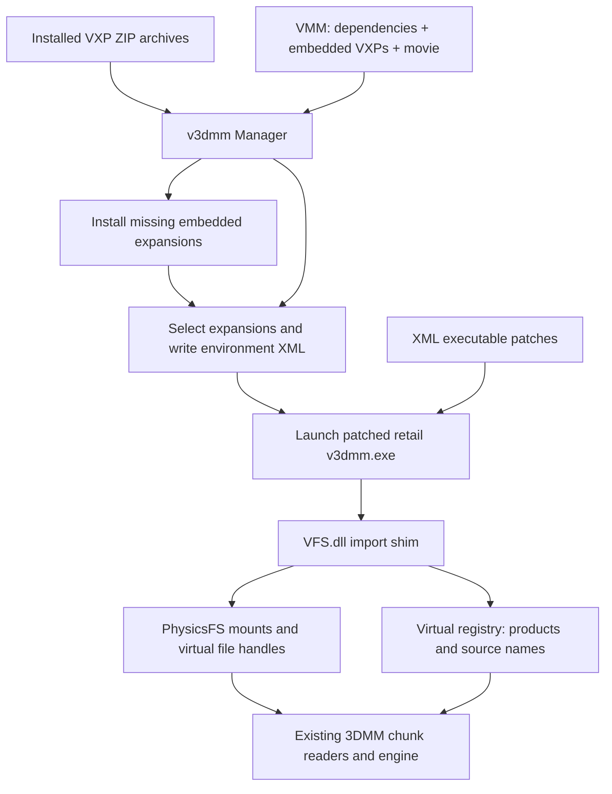

# 7gen / v3dmm research and port integration plan

Research date: 8 November 2026. Status: static analysis and local format checks
complete; native integration is planned, not implemented.

**The DLL hypothesis is close: v3dmm patches retail 3DMM to import a filesystem
and registry shim. The manager installs and selects content before launching
the patched executable. 7gen is the separate authoring toolkit.** A `.vmm`
bundles an ordinary chunky movie with expansion dependencies and, for portable
expansions, their ZIP archives. The port can implement those data contracts
directly without loading the old DLLs or patching its executable.

## Evidence and limits

Inputs are the repository's [7gen archive](../../v3dmm/7gen03b.zip) and
[v3dmm archive](../../v3dmm/v3dmm.zip). The former is an outer distribution ZIP
containing another `7gen03b.zip`, Python 2.3.4 and pygame installers. The latter
contains `v3dmm_014.exe`, an NSIS installer. Both layers were unpacked as data;
none of their installers, executables or DLLs was run.

Ghidra **12.1.2**, Java 21, `x86:LE:32:default:windows` was used to analyze
`v3dmmManager.exe`, `VFS.dll` and 7gen's `decompress3dmm.pyd`. Addresses below
are virtual addresses at the binaries' preferred image bases, **not file
offsets**. Descriptive function names below are interpretations; most original
symbols are absent. Evidence comes from decompilation, string cross-references,
the shipped XML patches, readable Python, and real package bytes.

| Input | SHA-256 |
| --- | --- |
| Outer `7gen03b.zip` | `95880864ce3029cf390aad789a79315c08ef71820f2d74feb9bad39af1682a4d` |
| Inner `7gen03b.zip` | `6d789ce525c4a658279fed5dfd61eeb7203cc6ce2f8f6ca4389432bb85b21363` |
| `v3dmm.zip` | `8814d0e12d7e1d642ee7a4ce99f6a40d96aa042be976db0335a6908117e908b4` |
| `v3dmmManager.exe` | `2846b840e2de7fe7f05dabc5cddaeb107c9a1c7ef1349055c813aafb152e15a1` |
| `VFS.dll` | `d059a20fb4a50e15f734dfa75607c4d423f10003492d29fa262e683f55c38797` |
| `physfs.dll` | `6e2baf2eddd5a9938be50cf3be420ab26e849905d1c7849fd01a8fd3883c3417` |
| `decompress3dmm.pyd` | `7712bd7c35be8f03daacdbea6e540f789557151ee58ed2d125d24ef6d03d74e8` |

This establishes the main loading/saving architecture and v1 container layout.
It does **not** establish frame-perfect playback, every malformed-input result,
or every collision/ordering rule. No retail-v3dmm differential playback was
performed. The remaining oracle work is an explicit first milestone below.

## What 7gen does

`7gen.pyw` launches `code/sevengeninterface.py`, a pygame chooser for Python
converters. This distribution includes:

| Converter | Result |
| --- | --- |
| `bmp2vxp` | Palette texture/material and browser thumbnail |
| `rgb2vxp` | Flat-colour background |
| `background2vxp` | Image/depth background with camera, lights and thumbnail |
| `campan2vxp` | Multi-camera background; optionally an accompanying `.vmm` movie |
| `obj2vxp`, `obj2vxptex` | Static model content, including textured variants |
| `md2_to_vxp` | Quake II MD2 frames/actions, textures, actor or prop template |
| `jkl2vxp` | Jedi Knight level geometry converted into prop content |
| `actorextractor` | Copies existing actor/prop chunk trees and can expose textures for editing |

`code/lib3dmm.py` reads and writes Kauai `CHN2` archives. A typical `.vxp` is a
ZIP with three related members:

```text
shortname.cfg       text metadata
shortname.3cn       engine content: TMPL, BMDL, ACTN, MTRL, TMAP, BKGD, ...
shortname.3th       browser content: TMTH / PRTH / BKTH / MTTH, GOKD, MBMP, ...
```

The content and thumbnail files use the existing chunky format; `.vxp` is the
packaging layer. For example, `bmp2vxp.Save3CN` links `MTRL -> TMAP`;
`Save3TH` links `MTTH -> GOKD -> MBMP`. The 12-byte `MTTH` payload names the
`MTRL` type and chunk number. MD2 output uses the existing template/action/body
formats rather than introducing a new animation runtime.

Generated CFGs contain `Name`, `Author`, `Original Author`, `Type=Portable`,
and usually `Content`, `Date` and `Generator`. The package's **shortname**, its
display **Name**, its **source ID**, and its assets' **chunk numbers** are
different identifiers. Do not substitute one for another.

`code/vxpinstaller.py::installVXP` reads
`HKCU\Software\TravisWells\v3dmmManager\paths:v3dmmdir` and copies the VXP into
its `Expansions` directory. It does not inject anything into 3DMM.

`code/vmmwrap.py::Wrap3dmmMovieInVmm` writes the container described below;
`campan2vxp.GenerateMovie` calls it after generating a normal movie.
`code/idgenerator.py` generates time-derived chunk numbers using a range ending
in 2014. That formula can exceed 32-bit limits today; preserve existing IDs,
but do not adopt its allocator for new authoring.

The bundled `.pyd` is an authoring-time decompression helper. Ghidra shows a
Python 2.3 `Decompressor` type, US/UK/French retail executable signature/offset
tables, a big-endian decoded-size reader (`0x100012a0`), and indirect decoder
calls (`0x100012d0`). Python's `get_size` and `decompress` callbacks are at
`0x10002290` and `0x100022e0`. This is separate from the VFS content loader;
the port already has native KCDC/KCD2 codecs and need not reproduce the helper.

The 7gen readme declares its Python and `.pyd` code GPL; the Python headers
specify GPL v2-or-later. Use the format findings for a new implementation;
copying that implementation into the MIT port would require a separate
licensing decision. No 7gen implementation or decompiled program code is added
to the port by this research.

## How v3dmm works



### Executable patching and launch

The installer's `Virtual3DMM/Patches/v3dmm.xpatch` targets `3dmovie.exe` and
produces `v3dmm.exe`, with UK, US and ES/FR variants. It replaces imported DLL
names including `KERNEL32.dll`, `COMDLG32.dll` and `ADVAPI32.dll` with `VFS.dll`,
and changes selected imported symbol names to the shim's aliases. Examples
confirmed by Ghidra's VFS exports:

| Retail API | Shim export | VFS address |
| --- | --- | --- |
| `CreateFileA` | `ZreateFileA` | `0x10006000` |
| `ReadFile` | `ZeadFile` | `0x10004cc0` |
| `WriteFile` | `VriteFile` | `0x10004bb0` |
| `SetFilePointer` | `ZetFilePointer` | `0x10004d60` |
| `FindFirstFileA` | `ZindFirstFileA` | `0x10006c70` |
| `MoveFileA` | `ZoveFileA` | `0x10004630` |
| `RegQueryValueExA` | `VegQueryValueExA` | `0x1000ce10` |
| `GetOpenFileNameA` | `ZetOpenFileNameA` | `0x10001690` |

The DLL also exports many forwarding APIs so imports redirected from a system
DLL still resolve. This is an **on-disk import substitution/proxy DLL** scheme;
the investigated launcher uses ordinary `CreateProcessA` (`0x0042b930`), not a
remote-thread DLL injector. The patch also changes two code comparisons and a
separate `silent startup.xpatch` edits `3dmovie.chk`. Their exact behavioral
effects have not been mapped here; they are not required to read the formats.

The manager writes `Temp/generated.environment.v3dmm.xml`
(`0x0040b3e0`, `0x0040b4d0`). Setup records contain `userdir`, `tempdir`,
`homedir`, `fullscreen`, `hires` and `cmdline`. Each selected expansion has
`type`, `name`, `archive`, `mount`, `regid` and `regname`; cached portable
expansions can also have `savearchive` pointing to the original VXP.

The launcher passes the environment filename after a private command-line
sentinel. VFS reads it (`0x1000e420`) and loads the XML (`0x1000eae0`) during
DLL attach (`0x100077f0`). Starting the patched executable without the manager's
handoff produces an error. The sentinel is a historical handshake, not a
security boundary or something the port needs to preserve.

### Virtual filesystem, registry and resource lookup

VFS initializes PhysicsFS (`0x10001790`) and mounts the selected archives or
cached directories (`0x1000f180`, mount helper `0x10001c00`). The mount helper
passes `appendToPath=1`. This proves append order at the mount layer; complete
chunk-collision precedence still depends on filename enumeration and 3DMM's
resource-manager ordering.

The virtual registry advertises an install root at `Z:\`, a base product at
SID 2, and expansion product registrations (`0x1000be20`, `0x1000ba80`). VFS
recognizes virtual paths by their initial `z`/`Z` (`0x100017b0`), converts
paths, and supplies file attributes, enumeration and virtual handles. Other
paths generally reach the original APIs. Helpers at `0x1000f640` through
`0x1000f730` perform case-insensitive virtual-path lookup, which matters on
Linux/macOS.

The manager's CFG handler (`0x00413e30`) gives `Type=Portable` these defaults:

```text
mount point = v3dmm
regid       = 6
regname     = Virtual3dmm/v3dmm
```

Consequently, **portable expansions share one source, SID 6**. They are not
assigned a new SID each time they are installed. Their `.3cn` and `.3th` files
become visible together under that virtual source. Existing asset chunk IDs
must remain intact. Library expansions supply their own mount/registration
information and are represented as external dependencies in saved VMMs.

CFG acceptance also checks the presence of name, author, type, mount point,
registration ID and registration name (`0x00416cf0`); Portable supplies the
last three defaults. Content category is optional. Real samples include LF and
CRLF CFGs and omit fields such as `Content` and `Generator`.

### Opening a VMM and installing its mods

Manager `0x00419ad0` reads the dependency table and matches names against
installed expansions. The comparison helper `0x004131d0` lowercases names;
this path is name-based, not a cryptographic version check. Missing entries
with nonzero payload sizes can be installed from the movie. A missing
zero-size dependency reports that the required expansion was not included.

The embedded-package installer (`0x00418470`) seeks to the recorded block,
checks `F0 0B`, copies exactly the declared archive size, and checks `FE EB`.
It writes `expansion.tmp`, parses/validates the expansion using
`0x00417e60`, and copies it to the configured expansion directory as a VXP
when not already installed. This is a persistent manager installation step,
followed by activation and launch, rather than movie code installing mods
while the engine plays frames.

Inside the running application, `ZreateFileA` detects `.vmm` and calls
`0x10009920`. That function skips the wrapper and payload blocks, rebases the
file object to the movie start, and verifies that required expansion names
are already active. If they are not, it tells the user to close 3DMM and
activate them in the manager. The real-file object's tell method subtracts
the stored base offset (`0x1000f350`) and absolute seeks add it
(`0x1000f400`). The chunky reader therefore sees a normal movie beginning at
logical offset zero.

### Saving

Manager `0x0041bb30` and VFS `0x10004040` write the wrapper from the active
expansion list. Portable packages contribute bytes; library entries have
size zero. Cached content can be read from a directory while `savearchive`
preserves the original portable archive for bundling.

VFS `ZoveFileA` intercepts the engine's final file move: it wraps an ordinary
saved movie for a `.vmm` target (`0x100042c0`) and rejects a `.3mm` destination
in this virtualized save path. The file-dialog wrappers expose both movie
types. Thus saving a portable movie is an outer-container operation; it
does not require new `SceneEventType` values or larger movie structures.

## VMM version 1 layout

This layout agrees between 7gen's writer, manager/VFS readers and all three
local samples checked. Integers are little-endian.

| Order | Bytes | Meaning |
| --- | --- | --- |
| 1 | 5 | ASCII `v3dmm` |
| 2 | 1 | Version `01` |
| 3 | 4 | Dependency count, including base `3dmm` |
| 4 | repeated | Per dependency: 4-byte embedded ZIP size, 2-byte name byte count, then that many name bytes |
| 5 | repeated for nonzero sizes | `F0 0B`, exactly `size` bytes of VXP ZIP, `FE EB` |
| 6 | rest of file | Ordinary `CHN2` movie file |

All dependency records precede all package blocks. Package sizes exclude the
two markers. A zero size means an externally supplied dependency and consumes
no block, **not an empty ZIP**. There is no separate movie-length field.
Names are legacy byte strings, not demonstrated UTF-8. Preserve their bytes
and distinguish display decoding from identity comparison. 7gen uses signed
32-bit Python packing for count/size; the manager handles 32-bit fields.
A new reader must do bounded arithmetic in 64 bits before allocating or seeking.

The base entry produced by 7gen is `size=0`, `length=4`, `name=3dmm`. Dependency
names are CFG display names, not ZIP member basenames. Archives do not need to
be unpacked into a retail install to determine the movie offset.

## Local checks performed

`movies/` was read only; its VMMs retain their read-only attributes. Extracted
research copies live exclusively under ignored `tmp/v3dmm-research/`.

| Sample | Dependency entries | Embedded VXPs | External names | Movie offset | Movie bytes |
| --- | ---: | ---: | --- | ---: | ---: |
| Shipped `blank.vmm` | 1 | 0 | `3dmm` | 20 | 12,713 |
| `Batman Sneak Peek.vmm` | 20 | 18 | `3dmm`, `3DMM Expansion Pack` | 735,014 | 9,474,258 |
| `CHASE-cleaned.vmm` | 595 | 591 | `3dmm`, `3DMM Expansion Pack`, `Doraemon`, `Nickelodeon` | 311,387,007 | 7,344,717 |

Every marker was checked, and every embedded ZIP passed CRC verification:
**609 packages total**. Each contained one CFG, one `.3cn`, and one `.3th`.
Batman's package members expand to 3,440,148 bytes; CHASE's expand to
**1,626,219,495 bytes**. This makes whole-movie expansion into RAM or eager
unpacking without a disk budget a poor default.

The port's existing `inspect-chunks` successfully read Batman's extracted
movie root/source table and the first embedded texture's `.3cn` / `.3th`.
The latter contained `MTRL/TMAP` and `MTTH/GOKD/MBMP`, all using chunk number
`0x01a6222b`. Dumping Batman's source GST through the native codec confirmed
`Virtual3dmm/v3dmm` at SID 6, independently of the manager decompilation.
These are container/chunk-read checks, not evidence of successful full playback.

## Native port design

The [existing expansion manager](expansion-manager.md) already provides staged
imports, ownership manifests, hashes, rollback, enable/disable state and
ownership-preserving uninstall. Its public API is currently fixed to three
packs (`std::array<..., 3>` in [studio_packs.h](../../inc/studio_packs.h));
arbitrary VXPs cannot simply be appended to it without a data-model change.

Useful existing integration points:

| Area | Current seam | Required addition |
| --- | --- | --- |
| Package storage | [pack_store.cpp](../../src/studio/pack_store.cpp), [pack_import.cpp](../../src/studio/pack_import.cpp) | Variable package records, original VXP retention, staged ZIP import and bounded materialization |
| Source registration | [pack_runtime.cpp](../../src/studio/pack_runtime.cpp), `StudioPacks::Products/Resolve` | Portable shared source and library identities; independent installed/enabled/active state |
| Engine resolution | [tagman.h](../../inc/tagman.h), [tagman.cpp](../../src/engine/tagman.cpp), `SetSourceResolver` | Explicit ordered archive sets for a source; directory-only resolution is insufficient for package ordering |
| Browser enumeration | [browser.cpp](../../src/studio/browser.cpp), `ThumbnailFileEnumerator` | Enumerate the same active `.3th` set and SID as runtime resolution |
| Startup registration | [utest.cpp](../../src/studio/utest.cpp), `_FInitProductNames` | Register portable source without reassigning existing movie IDs |
| Movie document | [movie.cpp](../../src/engine/movie.cpp), [studio.cpp](../../src/studio/studio.cpp) | Container-aware open/save coordinator and ownership of the selected content session |
| Headless inspection | [archive library](../../libraries/archive/include/three_mm/archive.h) | Container dependency enumeration and inner movie access usable without Studio |

Use a native format component, proposed as `libraries/v3dmm`, with bounded
VMM/VXP parsing and writing. It should expose dependency names/raw bytes,
archive byte ranges, metadata and the inner movie range without any GUI,
registry or process-launch dependency. Reuse the already pinned miniz ZIP
dependency and `ThreeMM::Archive` for content validation.

Keep physical storage and activation separate. Installed packages can be
content-addressed by hash while retaining legacy names and original archive
bytes. An immutable active source set records package order, archive order,
source registrations and provenance. Portable content contributes to one
SID-6 resource namespace; library content retains its own namespace. Reject
unresolvable source-ID/name conflicts rather than renumbering movie tags.

Initially materialize selected `.3cn` / `.3th` members to bounded private disk
storage and use native file/chunk readers. Keep each package's files separate;
do not merge chunk graphs or flatten colliding filenames into a shared folder.
Feed explicit archive lists to TagManager and the browser. Their order must
be determined by the oracle work, not the host filesystem. The existing
`ChunkyResourceManager::PcrfFindChunk` returns the first matching chunk, so
this is observable movie behavior.

A later lazy archive reader can reduce CHASE-sized disk usage. There is no
need to implement a general virtual `Z:` drive, emulate Win32 handles, or
introduce PhysicsFS just to get the first native version working.

## Implementation sequence and acceptance gates

### 0. Lock down unresolved legacy semantics

Use private copies and the retail-v3dmm oracle setup to record: same-name
different-byte packages; colliding ZIP member names; duplicate root chunk IDs;
package activation order; filename enumeration order; mixed-case/non-ASCII
names; missing library dependencies; cached versus uncached packages; and
save/reopen behavior. Read the bundled PhysicsFS implementation in Ghidra
where needed. Record supported Library/Testing CFG behavior separately from
the Portable path.

**Gate:** a small, redistributable synthetic fixture corpus plus expected
legacy results. Scope the initial release to supported package forms and
report unsupported forms explicitly. The 609 private real packages are useful
local regression inputs, not assets to add to Git.

### 1. Read-only format support and inspection

Implement the native format component and CLI/inspector dependency listing.
Validate counts, lengths, markers, ranges, ZIP CRCs, duplicate/case-colliding
member names, encryption/unsupported compression and malformed metadata.
Preserve unknown CFG fields and original name bytes. Apply separate budgets
for compressed package bytes, expanded bytes, chunk decoding and disk cache;
the current 128 MiB ISO-fixup reader limit must not become a total VMM limit.
Stream or map ranges instead of loading all of CHASE into memory.

**Gate:** correct offsets and dependency counts for blank, Batman and CHASE;
bounded failures on truncation, bad markers and integer-overflow fixtures;
no installation or movie mutation from read-only inspection.

### 2. VXP store and native resource activation

Generalize the fixed three-pack store without changing existing pack settings.
Add install/list/enable/remove for arbitrary portable VXPs and explicitly
supported library forms. Retain the original ZIP for byte-preserving re-save;
validate relative member paths and only materialize data members. Reuse
staging, publication, rollback and unchanged-file ownership checks.

Add the shared portable source, ordered `.3cn` lists and matching `.3th`
enumeration. Preserve unsigned chunk numbers, including values above
`INT32_MAX`; 7gen-generated IDs can use the full 32-bit range. Check filename
and chunk collisions using the oracle rules. Do not silently repair/re-ID
assets or suppress existing loader errors.

**Gate:** synthetic and 7gen-produced texture, prop, actor/action and background
assets appear in browsers and load through normal engine classes on Windows,
Linux and macOS. Existing Nickelodeon/Doraemon/Frankie tests still pass.

### 3. Open VMM with a controlled content lifetime

At the Studio open boundary, parse and resolve dependencies before loading
the inner movie. Existing installed packages satisfy legacy name lookup
according to milestone 0; retain hashes/provenance so conflicts are visible.
Install missing embedded packages transactionally; report missing external
libraries by name. Reuse the existing external-pack aliases only where their
identities are verified. `3dmm` is the built-in base dependency, not a new pack.

For the first release, select the required source set at launch and keep it
fixed while a movie is open, matching the legacy manager's lifecycle. If an
in-app open needs a different set, offer a controlled close/reopen transition.
Do not hot-swap resources while TAGs, undo records, browser caches or previews
still hold references. Stage and resolve the next session before closing the
current document; on failure leave the current document/content set intact.

Give the inner movie its own private working file initially. Keep the user's
VMM path as document identity and its container metadata alongside the movie,
including dependency order and original packages. Never edit the reference
bundle or confuse its logical offset with physical chunky offsets.

**Gate:** blank and Batman open; Batman reports its missing external library
correctly when absent. CHASE can resolve 591 portable packages without an
unbounded memory spike and names its three external libraries. Test failed
opens, cancel, close, reopening a different dependency set and cache cleanup.
Actual successful playback requires the external libraries and is a separate
recorded validation result.

### 4. VMM save, autosave and recovery

Keep `TAGOnFile`, movie version numbers and event formats unchanged. Save the
normal movie to a temporary working file, then atomically write a v1 wrapper
with ordered dependencies, original portable VXP bytes and zero-size library
entries. Match the verified legacy active-list policy initially; dependency
pruning is a later feature requiring complete tag/reference analysis.

Preserve `.vmm` identity through Save, Save As, autosave, recovery and reopen.
Never write a VMM wrapper under `.3mm`. Do not claim that extracting the inner
movie makes its external mod references playable in stock retail. Any export
of a mod-dependent document to `.3mm` needs an explicit supported policy and
retail validation; the first release should require `.vmm` for these documents.
Ordinary retail movie saves continue through their existing path.

**Gate:** native save/reopen and legacy v3dmm manager/retail save/reopen agree
for supported bundles; embedded ZIPs remain byte-identical; missing-library,
failed-write and recovery cases retain dependencies. Existing stock `.3mm`
retail compatibility checks remain green. No new required movie chunks,
struct growth or new event types are permitted.

### 5. Ship UI/automation support, then consider authoring tools

Add VMM file filters and startup routing, VXP import in Options > Expansions,
and MCP/CLI reporting for installed packages, active dependencies and missing
content. Run the editor workflows on Windows x64 and the native Linux/macOS
SDL hosts, including custom thumbnails, materials, actions, backgrounds,
sound/library references and movie save/reopen.

Supporting 7gen's **output** should ship before replacing its authoring GUI.
If authoring is wanted next, implement converters against existing native
chunk/model/image codecs: texture/background import first, static OBJ next,
MD2 action generation later. Use a modern collision-checked ID allocator.
Do not make Python 2.3, pygame 1.6, ImageMagick-era executables or retail
decoder extraction runtime dependencies of the port.

The first implementation PR should cover milestone 1 and its format fixtures.
Resource activation and document save/lifetime changes should be separate,
reviewable PRs after the collision/ordering evidence is settled.

## Reproducing the investigation

Use `tmp/v3dmm-research/` for extraction, the Ghidra project and exports. Extract
the inner 7gen ZIP with Python's `zipfile`; use `7z x` on the NSIS executable.
Do not execute the installer. The resulting binary paths should be:

```text
tmp/v3dmm-research/unpacked/Virtual3DMM/System/VFS.dll
tmp/v3dmm-research/unpacked/Virtual3DMM/System/v3dmmManager.exe
tmp/v3dmm-research/7gen/code/decompress3dmm.pyd
```

The committed [Ghidra exporter](../../tools/ghidra/ResearchDump.java) writes a
symbol/function/string/xref index and selected decompilation to an output
directory. It also recovers executable pointer targets and repairs a spurious
`_free` no-return inference observed in this manager. Treat its recovered
signatures and C output as analysis aids; check control flow before relying on
them. It changes the Ghidra database, never the input binary.

Example PowerShell commands (adjust Ghidra/JDK locations):

```powershell
$researchRoot = (Resolve-Path tmp/v3dmm-research).Path
$ghidraHeadless = 'C:/Users/wjbr/scoop/apps/ghidra/current/support/analyzeHeadless.bat'
$env:JAVA_HOME = 'C:/Users/wjbr/scoop/apps/temurin21-jdk/current'
$researchScripts = (Resolve-Path tools/ghidra).Path
$researchOutput = Join-Path $researchRoot 'ghidra-output'
& $ghidraHeadless $researchRoot V3DMMResearch `
  -import "$researchRoot/unpacked/Virtual3DMM/System/VFS.dll" `
  -scriptPath $researchScripts -postScript ResearchDump.java $researchOutput
& $ghidraHeadless $researchRoot V3DMMResearch `
  -import "$researchRoot/unpacked/Virtual3DMM/System/v3dmmManager.exe" `
  -scriptPath $researchScripts -postScript ResearchDump.java $researchOutput `
  0042b930 004131d0 00418470 0041ab10 00416cf0 0041bb30
& $ghidraHeadless $researchRoot V3DMMResearch `
  -import "$researchRoot/7gen/code/decompress3dmm.pyd" `
  -scriptPath $researchScripts -postScript ResearchDump.java $researchOutput
```

Use `-process <program-name> -noanalysis` in place of `-import <path>` to
re-export an existing project. VFS and the small `.pyd` are decompiled fully;
manager functions are selected by relevant string xrefs and explicit addresses.

The independent [read-only inventory script](../../tools/research_v3dmm.py)
checks wrapper ranges/markers, reports raw dependency names, package hashes,
CFGs, ZIP members and the inner movie offset. CRC verification reads decoded
members but does not write or execute them:

```powershell
python tools/research_v3dmm.py --verify-zip `
  tmp/v3dmm-research/unpacked/Virtual3DMM/System/blank.vmm `
  'movies/Batman Sneak Peek.vmm' 'movies/CHASE-cleaned.vmm' `
  > tmp/v3dmm-research/inventory.json
```

Private Ghidra databases, decompiled output, extracted movies and expansion
artwork stay in ignored `tmp/`; only the research scripts and findings belong
in the repository.
